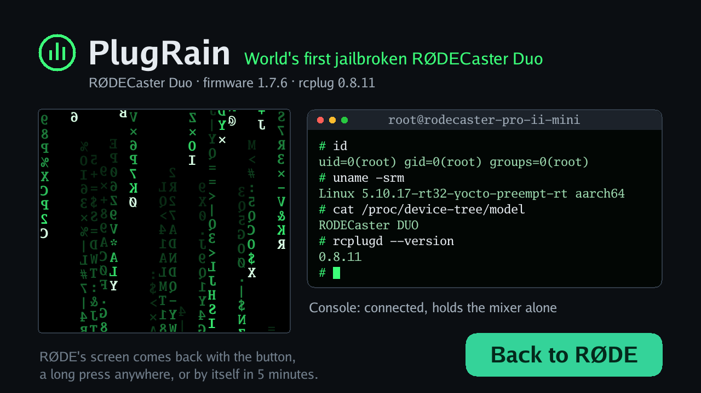

# PlugRain

**Experimental.** PlugRain shows that a plugin can have the device's screen: it stops
RØDE's screen for a few minutes, shows a page of its own and gives the screen back.
Green rain falls on it as smoothly as the display can show it, and a terminal proves
that the plugin runs as root on the device: *World's first jailbroken RØDECaster
Duo*.



It ran on a real Duo with firmware 1.7.6: upright, touches where the finger was, page
flips at 60 Hz, about 40 frames a second, RØDE's screen back with the button and by
its time. **It stays on this branch and is never part of a release or the catalog**;
its manifest has no update source. Build it with `make build-arm64` and add the folder
`dist/linux-arm64/screendemo` with the toolkit's *Add plugin*.

## How it starts and ends

- It starts only from the dashboard (*Start* on its card), never by itself, not after a
  restart of rcplug and not from a backup.
- Before it starts, rcplug stops RØDE's screen program; the device keeps mixing and
  recording, and the console holds the mixer alone meanwhile (full control).
- The page ends, and RØDE's screen comes back, with **Back to RØDE**, a press of three
  seconds anywhere on the screen, after the set number of minutes (default 5), with
  *Stop* in the dashboard, or when rcplug stops or is updated. If rcplugd itself ends
  while the page is shown, it gives the screen back when it starts again.
- The big encoder does nothing while the page is shown (RØDE's screen program reads
  it).

## What it shows

- **The rain:** columns of mirrored glyphs falling at their own speeds, the leading one
  bright, the trail fading. It moves by time, not by frame, so it falls at the same
  speed however many frames the device manages; the plugin's log says how many it
  managed (after ten seconds, then every minute).
- **The proof:** what `id`, `uname -srm`, `cat /proc/device-tree/model` and
  `rcplugd --version` would print, read by the plugin itself from the system (its user
  and groups, the kernel, the device tree's model name) and the host. A plugin that
  does not run as root shows `$` and its own ids.
- How the console holds the mixer, and the time left.

## Settings

| Option | Meaning |
|---|---|
| Back to RØDE after (minutes) | 1 to 30, default 5 |
| Language on the screen | English or German (the claim stays English) |

## Requirements

- rcplug 0.8.11 or later (permission `screen`; older versions do not load the plugin).
- A RØDECaster Duo: the page is drawn for its panel (720 × 1280, turned to landscape
  as RØDE's screen program draws it) and its touchscreen.

## How it draws

Only the Go standard library and rcplug's SDK, as for every plugin here:

- **Display:** the kernel's DRM interface with plain ioctls
  ([display_linux.go](display_linux.go)): it finds the connected panel and its mode and
  makes two buffers of its own (XRGB8888). It draws into the one not on the panel and
  flips them at the panel's refresh (a page flip, waited for), so nothing tears. If
  flipping does not work, it goes on with one buffer at about 30 frames a second.
- **Frames:** the page is drawn on a landscape canvas of 1280 × 720 and turned by 90°
  into the portrait buffer, with the page's top on the panel's right, as RØDE's screen
  program has it. Only what moves (the rain, the cursor; about a fifth of the panel) is
  drawn and copied every frame; the rest only when it changes, drawn in the background
  while the rain goes on ([scene.go](scene.go)).
- **Touch:** evdev, found by its name (RØDE's screen program binds the touchscreen's
  driver again when it starts, so its number can change), the single-touch axes scaled
  by the ranges the driver reports ([touch_linux.go](touch_linux.go)).
- **Text:** glyph atlases of the Go fonts in [font/](font/), made by
  [tools/fontatlas](../tools/fontatlas/main.go) (`cd tools/fontatlas && go run . -out
  ../../screendemo/font`).

It writes nothing on the device but the backlight: if RØDE's screen program had dimmed
it below a tenth or switched it off, the page turns it up to half and puts the old value
back when it ends, before RØDE's screen program starts again and sets its own. Its
buffers go with it.

## Development

```sh
go run ./screendemo --png page.png              # the page as an image, no device needed
go run ./screendemo --png page.png --lang de    # in German
go test ./screendemo                            # turn, touch, button, rain, frames in parts
```

Without a console the *Console* line says *not reachable*. On a machine with a DRM card,
the tests also find its output and make two buffers, without showing them.
