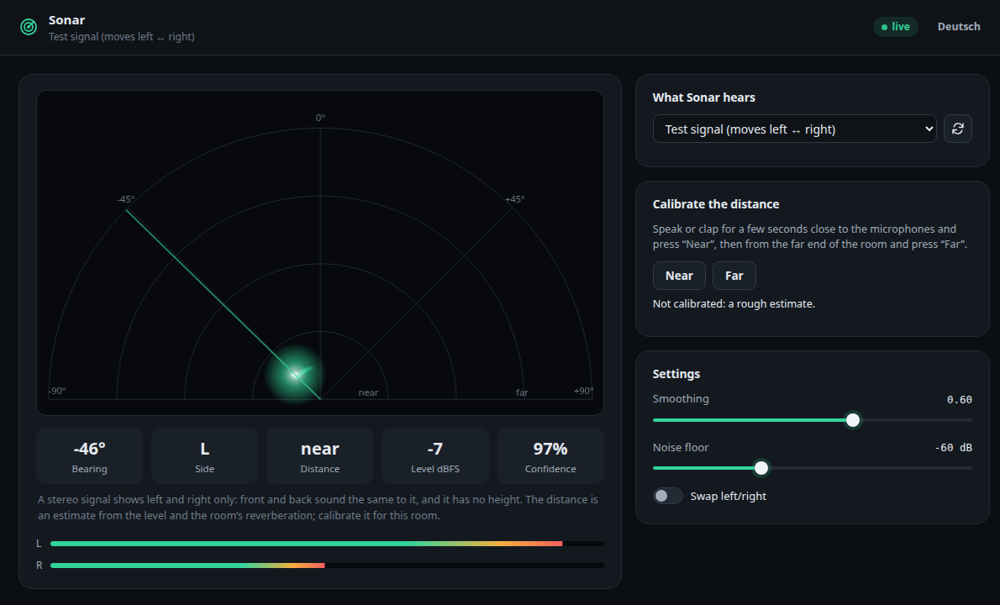

# Sonar

Sonar estimates where a sound comes from on a stereo channel and shows it as a live
radar. It began as a game aid for hide-and-seek among friends: put a stereo microphone
on a channel and see which way the noise is.



## Signal path

```
audio source ──▶ blocks of 1024 frames ──▶ direction estimate ──▶ SSE ~30/s ──▶ radar page
```

Sources:

| Source | Meaning |
|---|---|
| `test` | Built-in signal that sweeps from left to right; works without hardware |
| `alsa:<device>` | Capture with `arecord -D <device>` (S16_LE, stereo), e.g. `alsa:default` or `alsa:hw:0,0` |
| `jack:<port>,<port>` | Two JACK ports, e.g. `jack:system:capture_1,system:capture_2`, bridged into Sonar (see below). The way to the desk's audio on the RØDECaster Duo. |
| `wav:<file>` | Loops a 16-bit stereo WAV file at Sonar's sample rate. Set it with `--source` or the API (`POST api/config`); the web page has no file picker. Over the API only files inside the plugin's data directory are accepted. |
| `stdin` | Raw S16_LE stereo on standard input (command line only) |

Sonar ships with the `test` source, so a fresh install shows the built-in sweep. Pick
a JACK pair (on the Duo) or an ALSA device in the web UI to listen to real audio.

### Real audio on the RØDECaster Duo: JACK

On the Duo the whole desk is a JACK graph (JACK2 1.9.20, firmware 1.7.x):
`jackd` holds the card's only capture device (`hw:0,3`) and playback device
(`hw:0,0`), and `rc_audio_mixer` is a JACK client whose ports carry every input and
output of the desk. So `arecord` cannot open the hardware there, and the ALSA
entries the UI lists on the Duo (`default`, `pulse`, …) carry no desk audio.

A `jack:` source therefore bridges two JACK ports into Sonar, with tools the
firmware ships and nothing installed:

1. it loads `snd-aloop` as ALSA card `RcplugLoop` (index 7, two substreams), unless
   a loopback card is there already, and picks a substream no other program holds;
2. it runs `alsa_out` as JACK client `rcplug-sonar`, playing into the loopback;
3. it connects the two chosen ports to it with `jack_connect`;
4. it records the other end of the loopback with `arecord`, like an ALSA source.

Switching to another source, or stopping Sonar, ends `alsa_out`, which removes its
connections; the module stays loaded until the next reboot.

**This is opt-in.** It adds a client to RØDE's audio graph, which runs with very
short periods (112 frames at 48 kHz): if the device is short of CPU, the whole desk
could click or drop out. The web UI lists the stereo pairs JACK offers (consecutive
ports of one client: `system:capture_1` + `_2`, `JUCEJack:out_1` + `_2`, …) and asks
before using one. It has been tested against the firmware's own JACK tools and with
JACK2 and a real ALSA loopback, but **not yet on a real Duo**. Which port carries
which input of the desk is not known yet; the diagnostics bundle lists the JACK
ports and their connections (`jack_lsp -c -p`) to find out. If anything sounds
wrong, switch Sonar back to `test`.

### Channels of the desk

Every channel strip of the console has a "◉ Sonar" button (a plugin action, see
[plugin-api.md](https://github.com/Hustenreizjuengling/rcplug/blob/main/docs/plugin-api.md#actions)), and Sonar has a channel list read from the
console. A channel needs an audio source assigned once: Sonar asks "which input carries
this channel?" and remembers the answer per console source (`combo1`, `usb2`, …), so the
next time the channel opens with the right input. The web UI lists the JACK pairs and
capture devices it finds; which of them carries which channel of the desk has not
been checked on hardware yet (see [device-notes.md](https://github.com/Hustenreizjuengling/rcplug/blob/main/docs/device-notes.md)).

The chosen source and the tuning are saved in the plugin's data directory and survive
restarts. They win over the command-line flags below; delete
`data/sonar/sonar.state.json` to go back to the flags.

## How the direction is estimated

[`internal/dsp`](internal/dsp) combines two classic cues:

- **Level difference (ILD):** the louder channel gives the left/right balance.
- **Time difference (ITD):** the channel that hears the sound first points to the
  source. It is estimated by normalised cross-correlation over at most ±900 µs; the
  height of the correlation peak doubles as the **confidence**.

The result is an azimuth from −90° (left) to +90° (right), the level in dBFS, the
confidence, the left and right levels and the estimated delay. The level difference
alone reaches about ±60° (one channel silent); the outer part of the range needs the
time difference as well. It is smoothed with an
exponential moving average. Tests cover hard left and right, centre, pure time
panning, silence and the flipped orientation.

This only works with a real stereo pair (two microphones or a stereo microphone).
A mono source panned in the mixer has a level difference but no time difference, so
the confidence stays low.

## Settings

| Setting | Flag | Meaning |
|---|---|---|
| Source | `--source`, env `SONAR_SOURCE` | see above (default `test`) |
| Smoothing | `--smoothing` | 0 (none) to 0.99; higher is calmer and slower |
| Noise floor | `--noise-floor` | −120 to −1 dBFS; below this level the input counts as silence (default −60) |
| Swap left/right | `--flip` | for a reversed microphone |
| Sample rate | `--rate` | 8000 to 192000 Hz (default 48000) |
| Block size | `--block` | 64 to 65536 frames per estimate (default 1024) |
| Listen address | `--addr` | set by rcplugd (`127.0.0.1:{{port}}`); default `127.0.0.1:8081` when run alone |
| Version | `--version` | print the version and exit |

Values outside these ranges make Sonar exit with an error at start. Settings changed
in the web UI apply at once and are kept in the data directory (they win over the
flags); changing the source restarts the capture. A failing source is retried with a
growing pause (1 to 10 s) and the error is shown on the page, for ALSA and JACK with
`arecord`'s own message.

## API

| Request | Content |
|---|---|
| `GET stream` | Server-Sent Events, about 30 per second: `{"az", "level", "levelDb", "conf", "l", "r", "lagUs", "source", "err", "ts"}` |
| `GET api/config` | Current settings, including `channel` and the `channels` assignments |
| `POST api/config` | Any subset of `{"source", "smoothing", "flip", "noiseFloor", "channel", "assign": {"channel", "source"}}`; needs `X-Rcplug: 1`. `channel` selects a console source and switches to its assigned audio source; `assign` stores (or with an empty source removes) an assignment. |
| `GET api/sources` | Current source, ALSA capture devices, JACK stereo pairs, built-in sources |

At most 16 streams are served at once.
